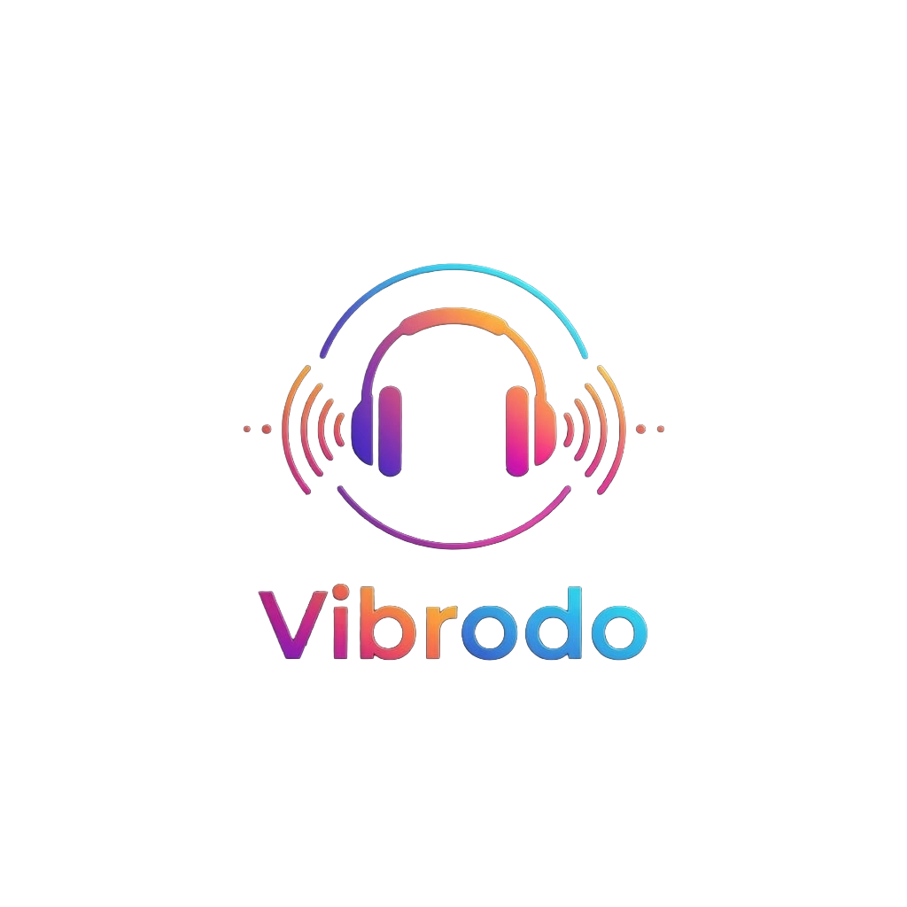
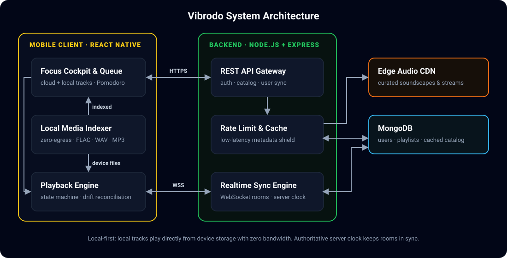

### Distraction-free audio & deep-work cockpit.
**Cloud soundscapes, local library, and synchronized focus rooms in one unified queue.**

 

[**Architecture**](./ARCHITECTURE.md) &nbsp;·&nbsp; [**Security & Privacy**](./SECURITY.md) &nbsp;·&nbsp; [**Team**](./TEAM.md) &nbsp;·&nbsp; [**Roadmap**](#roadmap)

---

## Why Vibrodo?

Deep work breaks the moment you switch apps to skip a track, dodge algorithmic feeds, or manually sync a playlist with friends during late-night study and coding sessions.

Vibrodo brings **curated cloud soundscapes**, **on-device local audio**, and an **integrated focus timer** into a single AMOLED-first interface—built to stay out of your way while you execute.

---

## Core Capabilities

| | Capability | Overview |
| :-: | :-- | :-- |
| 🎧 | **Hybrid Unified Queue** | Stream curated mood soundscapes alongside local device tracks (`FLAC`, `WAV`, `ALAC`, `MP3`) in one seamless queue. |
| 💾 | **Local-First Resolution** | Automatically indexes on-device audio and prioritizes local copies for zero-latency, zero-bandwidth playback. |
| ⏱️ | **Integrated Focus Cockpit** | Built-in Pomodoro cycle engine coupled directly to playback state—built for uninterrupted coding and study blocks. |
| ⚡ | **Synchronized Listening Rooms** | Real-time WebSocket rooms ("Vibing Now") powered by an authoritative server clock so every listener stays locked on the same beat. |
| 🌑 | **AMOLED-First Design** | Pure `#020617` dark surfaces engineered to minimize eye strain and OLED battery drain during night sessions. |
| 📱 | **Background Continuity** | Deterministic playback state machine resilient to app backgrounding, audio interruptions, and network handoffs. |

---

## System Snapshot

  

For component boundaries, playback state transitions, and sync design principles, see **[ARCHITECTURE.md](./ARCHITECTURE.md)**.

---

## Tech Stack

| Layer | Technologies |
| :--- | :--- |
| **Mobile Client** | React Native, Expo Router, TypeScript, Zustand, Reanimated, Native Audio Modules |
| **Backend & Realtime** | Node.js, Express, WebSockets, JWT Authentication |
| **Data & Delivery** | MongoDB, Edge Audio CDN, AsyncStorage (Local Persistence) |

---

## Roadmap

- [x] AMOLED-first interface & mood-driven session workflows
- [x] Hybrid cloud + on-device local audio playback engine
- [ ] Integrated Pomodoro focus timer & offline state persistence *(in progress)*
- [ ] Cloud account sync for liked tracks & session history *(in progress)*
- [ ] Low-latency WebSocket listening rooms with clock-drift reconciliation *(next)*
- [ ] Multi-layer ambient soundscaping & adaptive audio mixing *(planned)*

---

## Repository & IP Notice

Vibrodo's core mobile application, realtime sync server, and proprietary audio processing pipelines are maintained in **private repositories** during active development. This public repository serves as our architectural overview, security baseline, and collaboration hub.

---

## Team

Built across **IIIT Kalyani** and **NIT Durgapur**. See **[TEAM.md](./TEAM.md)** for leadership profiles.

| Name | Role | Links |
| :--- | :--- | :-- |
| **Abhinav Deval** | Founder · Systems & Mobile Architecture | [GitHub](https://github.com/abhinavkdeval08-design) · [Portfolio](https://abhinavkdeval.vercel.app/) |
| **Aanya Jain** | Co-Founder · Backend & Realtime Infrastructure | [GitHub](https://github.com/AanyaJain0811) · [LinkedIn](https://www.linkedin.com/in/aanya-jain-509694385) |

---

## Connect

📸 [@vibrodo.music_24](https://www.instagram.com/vibrodo.music_24/) &nbsp;·&nbsp; ✉️ `abhinavceovibrodo@gmail.com`

Vibrodo — Built for pure focus listening.

